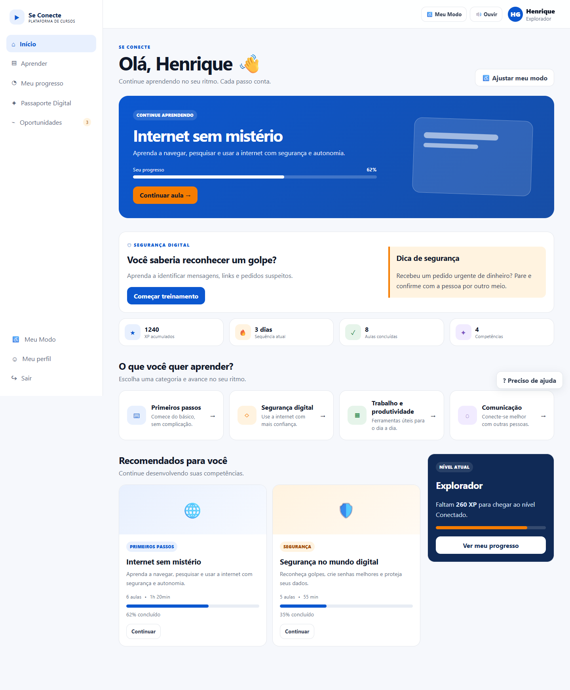

# Se Conecte

Plataforma de inclusão digital com minicursos, videoaulas, atividades práticas e certificados de conclusão. Conteúdos de informática básica e segurança na internet em uma interface responsiva e acessível.

## Funcionalidades

- Catálogo de cursos com busca e filtros.
- Videoaulas com resumo escrito e atividades de fixação.
- Trilha de segurança digital com oito módulos e cinco simulações de golpes.
- Certificados com nome completo, data e opção de imprimir ou salvar como PDF.
- Progresso, conquistas e Passaporte Digital.
- Ajustes de contraste, tamanho do texto, leitura em voz alta e explicações simplificadas.
- Cache da aplicação para acesso offline ao conteúdo local.



## Executar localmente

Abra `index.html` no navegador para explorar a interface. O login demonstrativo vem preenchido e não realiza autenticação no servidor.

Para testar o cache offline, execute na pasta do projeto:

```sh
python -m http.server 8000
```

Acesse `http://localhost:8000`. Com PHP instalado, também é possível usar `php -S localhost:8000`.

## Cursos e certificados

Em **Aprender**, escolha um curso e avance pelas aulas. Nas videoaulas, a resposta correta libera a conclusão. Ao atingir 100% do curso, o certificado aparece em **Meus certificados**. A trilha Segurança Digital exige concluir os oito módulos e as cinco simulações.

Cadastre seu nome completo em **Meu perfil** antes de concluir o curso. Cada certificado preserva o nome e a data registrados na emissão. Para exportar, clique em **Imprimir / Salvar como PDF** e escolha o destino na janela do navegador.

Perfil, progresso e certificados ficam armazenados no navegador utilizado. Não há sincronização entre dispositivos; limpar os dados do navegador remove os registros locais. Os identificadores dos certificados não possuem verificação pública.

Os vídeos são carregados do YouTube após o clique e precisam de internet. Se a incorporação estiver indisponível, use o link para assistir no YouTube. Legendas dependem do vídeo original. O cache guarda arquivos da aplicação, sem baixar vídeos.

## Tecnologias e estrutura

HTML, CSS e JavaScript sem framework; Web Speech API; Manifest e Service Worker; estrutura de API com PHP 8 e PDO; modelo de dados para MySQL/MariaDB.

```text
assets/css/    Estilos e acessibilidade
assets/js/     Catálogo, navegação, atividades e certificados
backend/       Estrutura da API PHP
database/      Scripts SQL
prints/        Capturas das telas
tests/         Verificações de interface e acessibilidade
```

## Backend

A interface funciona com dados locais e ainda não está integrada à API. Para explorar o backend:

1. Inicie PHP e MySQL/MariaDB, por exemplo pelo XAMPP.
2. Importe `database/se_conecte.sql` e depois `database/002_inclusao_seguranca.sql`.
3. Ajuste `backend/config.php` para seu ambiente local.
4. Acesse `backend/api.php?action=cursos` ou `backend/api.php?action=vagas`.

Antes de disponibilizar contas reais, é necessário implementar autenticação, autorização, validação no servidor e armazenamento por usuário. O login atual é demonstrativo.

## Verificação

Com o servidor local em execução e Chrome ou Edge instalado no Windows:

```sh
python tests/run-browser.py --base http://127.0.0.1:8000 --width 390
python tests/run-browser.py --base http://127.0.0.1:8000 --width 1440
```

O roteiro verifica navegação, acessibilidade, videoaulas, certificados, persistência local e carregamento offline.

## Conteúdo complementar

Vídeos de informática: [O que é um computador?](https://www.youtube.com/watch?v=JdSTF0iYYhI) e [Arquivos e Pastas](https://www.youtube.com/watch?v=7DH3CHCuYSI). Segurança: [introdução](https://www.youtube.com/watch?v=KvPtIl-Gz2E), [cuidados com senhas](https://www.youtube.com/watch?v=whSgBpNyr2c) e [uso de senhas](https://www.youtube.com/watch?v=8goOO4f6ffs), do Curso em Vídeo. Resumos e atividades são materiais de apoio, sem reproduzir transcrições dos vídeos.
